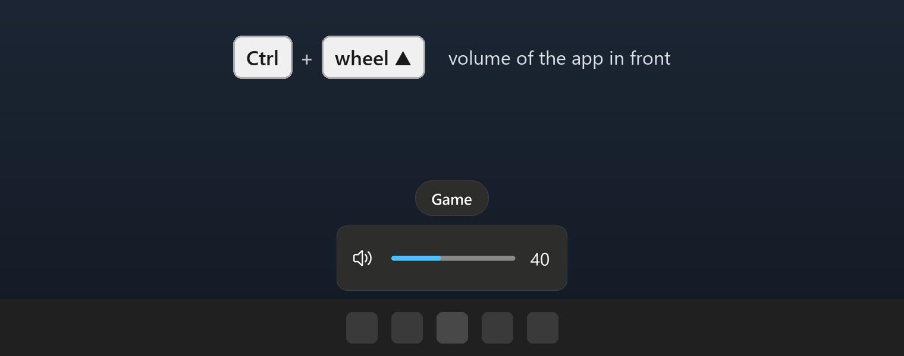
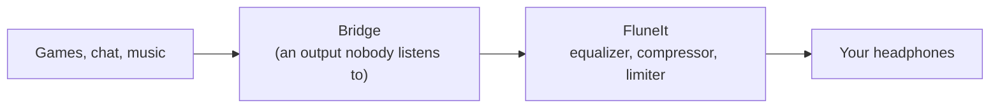
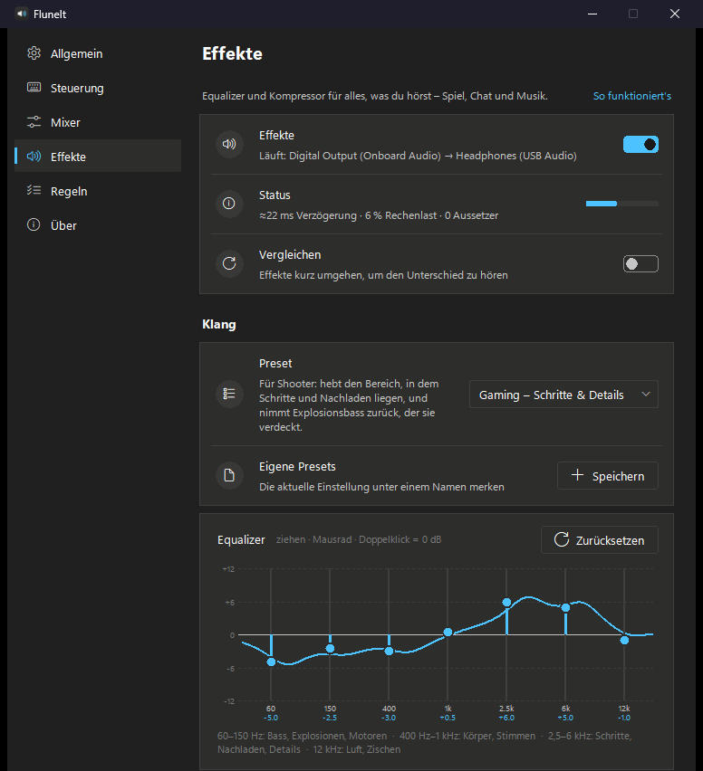
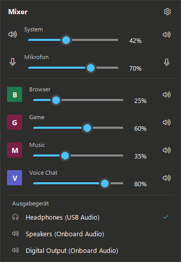

<p align="center"></p>

<h1 align="center">FluneIt</h1>

<p align="center">
  <b>The volume wheel on your keyboard, for every app on its own.</b><br>
  Hold a key, turn the wheel: the game, the music or the voice chat gets louder or quieter.
</p>

<p align="center">
  <a href="https://github.com/FynnXland/FluneIt/releases/latest"></a>
  <a href="LICENSE"></a>
  
</p>

<p align="center">
  <a href="https://github.com/FynnXland/FluneIt/releases/latest"><b>Download for Windows</b></a> &nbsp;·&nbsp;
  <a href="README.de.md">Deutsch</a> &nbsp;·&nbsp; <a href="docs/">Documentation</a> &nbsp;·&nbsp;
  <a href="CHANGELOG.md">Changelog</a>
</p>

<p align="center">
  
  <br><i>One wheel, four targets. The overlay looks like the Windows volume display and appears in the same place.</i>
</p>

Windows has one volume wheel and a mixer that hides several clicks deep. FluneIt
lets the wheel change the app you are looking at, the microphone, your music or
your voice chat, depending on the key you hold, and shows what it did in an
overlay that looks like the one from Windows. On top, an optional equalizer and
compressor shape everything you hear, with presets made for games. No account,
no driver to install, and FluneIt only goes online when you ask it to look for
an update.

> [!NOTE]
> The interface is in German. This README gives the German labels with their
> meaning, for example *Effekte* (effects).

## How it works



The volume keys work without any of this: FluneIt sets the volume of the chosen
app in the Windows mixer. Only the optional effects need a detour, because
Windows does not let programs change other programs' sound without a driver.
While effects are on, Windows plays to a *bridge*, an output with nothing
plugged in, and FluneIt records it there, applies the effects and plays the
result on your real device. Turning effects off switches everything back.
Details: [docs/architecture.md](docs/architecture.md).

## Features

**The wheel follows the key you hold.** <kbd>Ctrl</kbd> for the app in front,
<kbd>Ctrl</kbd>+<kbd>Shift</kbd> for the microphone, <kbd>Alt</kbd> for the
music app from any window, <kbd>Ctrl</kbd>+<kbd>Alt</kbd> for the voice-chat
apps together, <kbd>Shift</kbd> for tracks. The wheel alone still changes the
system volume.

**Effects for what you hear** (optional, off until you turn them on).
<p align="center"></p>

- **Gaming presets:** *Schritte & Details* for shooters, *Ausgewogen* for
  role-playing games, *Leise Nacht* for late sessions, plus music, film, speech
  and bass. Save your own under a name.
- **Seven-band equalizer** you drag with the mouse, a compressor with one
  *Stärke* (strength) slider, and a safety limiter that always stays on.
- **Vergleichen** (compare) switches the effects off for a moment so you can
  hear the difference.
- **Tray mixer:** click the tray icon for system, microphone and every app with
  sound, plus the output device.
- **Overlay that replaces the Windows one** for the system volume as well, so
  you never see two at once.
- **Rounding:** shortly after you stop turning, the volume snaps to the nearest
  multiple of 5 % (or 10 %, or off).
- **Rules per app:** always start an app at a fixed volume, always muted, or
  keep the wheel away from it.

<details><summary><b>More features</b></summary>

- **Media keys:** <kbd>Shift</kbd> + wheel changes the track, <kbd>Shift</kbd> +
  mute key plays and pauses, <kbd>Shift</kbd>+<kbd>Alt</kbd> + wheel seeks by
  10 seconds. The overlay shows title, artist and cover.
- **Skip protection:** skipped a track by accident? Going back within 60
  seconds returns to the second where you were.
- **Several music players:** <kbd>Alt</kbd> + wheel controls one of them; the
  others appear dimmed, and <kbd>←</kbd> <kbd>→</kbd> switch while the overlay
  is visible.
- **Mode hint:** hold a modifier for a moment and a small label tells you what
  the wheel would change.
- **Microphone chain:** noise suppression, noise gate and correction for your
  microphone. Other apps only receive it through a virtual audio cable such as
  VB-CABLE, which FluneIt does not install.
- **Hide apps and devices** from the mixer with a right click.

</details>

## A look inside

<p align="center"></p>

The tray mixer opens with a click on the speaker icon in the notification area.
All app and device names in these pictures are invented sample data.

## Installation

| Platform | Get it | Notes |
|---|---|---|
| Windows 11 | [`FluneIt.exe`](https://github.com/FynnXland/FluneIt/releases/latest) | A single file of about 60 MB, no installer. Uses about 80 MB of memory while idle. |
| Windows 10 | same file | Should work, but has not been tested. |
| Linux | from source, see [Development](#development) | Experimental: the code exists but has only been checked by import tests, not on a real desktop. |

> [!TIP]
> FluneIt is not signed, so Windows SmartScreen may warn you when you start it
> the first time. Choose *More info → Run anyway*. To make sure the file is the
> one from this page, compare its checksum with `SHA256SUMS.txt` from the
> release: `Get-FileHash FluneIt.exe -Algorithm SHA256`.

### First run

1. Put `FluneIt.exe` in a folder where it can stay, for example
   `%LOCALAPPDATA%\Programs\FluneIt`, and start it.
2. A welcome window shows the main key and offers *Mit Windows starten*
   (start with Windows).
3. FluneIt now sits in the notification area. Right-click the icon for
   *Einstellungen öffnen* (open settings).

To use effects, open *Effekte* and turn on the switch. A short dialog asks for
your headphones and for the bridge, an output with nothing plugged in, such as
the HDMI output of your graphics card or the digital output of the mainboard.

## Everyday use

| Keys | What happens |
|---|---|
| Wheel | System volume, as always |
| <kbd>Ctrl</kbd> + wheel | Volume of the app in front |
| <kbd>Ctrl</kbd> + mute key | Mute or unmute the app in front |
| <kbd>Ctrl</kbd>+<kbd>Shift</kbd> + wheel / mute key | Microphone |
| <kbd>Alt</kbd> + wheel / mute key | The music app, from any window |
| <kbd>Ctrl</kbd>+<kbd>Alt</kbd> + wheel / mute key | Voice-chat apps (Discord, TeamSpeak, Teams …) |
| <kbd>Shift</kbd> + wheel | Next or previous track |
| <kbd>Shift</kbd> + mute key | Play or pause |
| <kbd>Shift</kbd>+<kbd>Alt</kbd> + wheel | Seek within the track |

The keys can be changed under *Steuerung* (controls); all except the one for the
app in front can also be turned off. The <kbd>Fn</kbd> key cannot be used:
keyboards handle it themselves and never tell Windows about it.

**Effects delay.** The detour through the bridge costs time. The effects page
shows FluneIt's estimate; on the development machine it was about 20 ms for
*Niedrig* (low), 40 ms for *Mittel* (medium) and 100 ms for *Sicher* (safe).
For games take *Niedrig*; if it crackles, go one step up.

**What the gaming presets can and cannot do.** A game delivers one finished
mix. Single sounds like "only footsteps" cannot be pulled out of it, only their
frequency range. *Schritte & Details* raises the range where steps and reloads
sit (about 2.5 to 6 kHz) and lowers the bass that covers them.

## Privacy and your data

| What | Where | Leaves your PC? |
|---|---|---|
| Settings | `%LOCALAPPDATA%\Fluneit\config.json`, or next to `FluneIt.exe` if a `config.json` is already there | No |
| Log file | `%LOCALAPPDATA%\Fluneit\fluneit.log`: program starts and errors; can name apps, audio devices and folders, never audio | No |
| Autostart | a task named *Fluneit* in the Windows Task Scheduler | No |
| Update check | a request to `api.github.com`, only when you click *Nach Updates suchen* | Only this request |

FluneIt does not record or store audio. With effects on, sound passes through
it in memory on its way to your headphones. The experimental Linux version also
loads album art when a music player offers it as a web address. To remove FluneIt completely, turn
off *Mit Windows starten*, quit it from the tray menu (*Beenden*) and delete
`FluneIt.exe` and the folder `%LOCALAPPDATA%\Fluneit`.

## Troubleshooting

| Problem | Fix |
|---|---|
| No sound after FluneIt crashed while effects were on | Start FluneIt again: it switches the default device back. Or choose your headphones in the Windows sound settings. |
| Effects crackle | *Effekte → Verzögerung*: one step higher. |
| The effects page says libraries are missing | Only when running from source: `pip install -r requirements.txt`. |
| The wheel does nothing with <kbd>Ctrl</kbd> held | The app in front may have no sound right now; the overlay then says *kein Audio* (no audio). Check *Regeln* (rules) for an app that is excluded. |
| FluneIt does not start with Windows | *Allgemein* (general) shows how autostart is set up. The log records every start, marked *Anmeldung* (logon) or *manuell* (by hand). |
| Something else | Open an [issue](https://github.com/FynnXland/FluneIt/issues/new/choose) and add a log excerpt (*Über → Log-Datei öffnen*). |

## Development

```powershell
git clone https://github.com/FynnXland/FluneIt.git
cd FluneIt
python -m venv .venv
.venv\Scripts\Activate.ps1
python -m pip install -r requirements-dev.txt
python -m fluneit                 # start from source
python -m pytest                  # tests, no audio device needed
.\packaging\build_exe.ps1         # builds dist\FluneIt.exe
```

Python 3.11 on Windows. More in [CONTRIBUTING.md](CONTRIBUTING.md) and
[docs/architecture.md](docs/architecture.md).

## Acknowledgements

FluneIt builds on [pycaw](https://github.com/AndreMiras/pycaw) and
[comtypes](https://github.com/enthought/comtypes) for the Windows audio
interfaces, [pystray](https://github.com/moses-palmer/pystray) for the tray
icon, [NumPy](https://numpy.org/) and [SciPy](https://scipy.org/) for the
effects and [python-sounddevice](https://github.com/spatialaudio/python-sounddevice)
for playback. All bundled components and their licenses are listed in
[THIRD-PARTY-NOTICES.md](THIRD-PARTY-NOTICES.md).

## License

FluneIt is released under the [MIT License](LICENSE).

Unless you explicitly state otherwise, any contribution you submit for inclusion
in this project is licensed under the MIT License, without additional terms or
conditions.

Copyright © 2026 FynnXland
