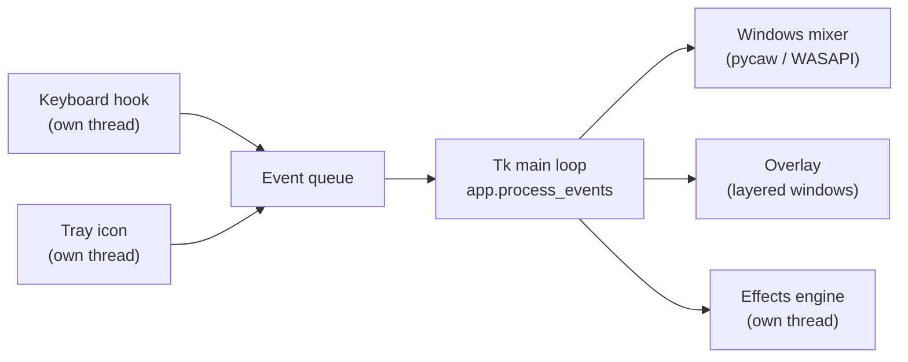

# Architecture

Status: FluneIt 2.0.0. For contributors; users start with the [README](../README.md).

## Overview

Everything that changes state runs in the Tk main thread. The keyboard hook and
the tray icon run in their own threads and only put events or callables into
`event_queue`; `process_events` collects them every 30 ms (75 ms when idle),
combines several wheel ticks into one change, and then talks to the Windows
mixer and the overlay. The effects engine has its own thread because audio
cannot wait for the user interface.

## Modules

| Module | What it does |
|---|---|
| `fluneit/app.py` | Settings, keyboard hook, volume logic, overlay, media keys, rules, effects lifecycle, autostart, update check, tray icon, `main()` |
| `fluneit/ui.py` | Settings window, tray mixer, first-run window, dialogs, the design tokens (`T`) and widgets |
| `fluneit/fx_dsp.py` | Signal processing only: equalizer (biquads), compressor, noise gate, noise suppression, limiter, presets. No I/O, testable without audio devices |
| `fluneit/fx_engine.py` | Audio in and out for the effects: WASAPI loopback capture of the bridge, playback with sounddevice |
| `fluneit/linux_*.py` | Experimental Linux back end: X11 key grabs, PipeWire/PulseAudio, MPRIS, tray, overlay |

Platform-specific code sits behind `IS_WINDOWS`. Linux modules are never
imported on Windows, and the Windows build excludes them.

## Keys

`WH_KEYBOARD_LL` sees every key press. The hook only acts on the volume and mute
keys (and on the arrow keys while the music overlay is visible). Which function
a key combination triggers comes from `HOOK_FUNCS`, built by `apply_config()`
and sorted so that the combination with the most keys wins: Ctrl+Shift
(microphone) beats Ctrl (app) and Shift (media).

## Overlay

The overlay is a copy of the Windows 11 volume display, measured at 100 %
scaling and scaled with the DPI. It is drawn with Pillow (`OSD._render_box`,
`OSD._render_pill`) and shown in layered windows with per-pixel alpha, so the
corners are smooth and clicks go through. When FluneIt handles a volume key, a
WinEvent hook hides the Windows display. If that hiding cannot be confirmed,
FluneIt shows nothing and leaves the Windows display alone, so there are never
two at once.

## Effects: the bridge

Windows offers no supported way for a program to process other programs' sound
without a driver. The options that were checked and rejected:

- **Audio Processing Objects** (the Equalizer APO approach) work without
  latency, but are an unsupported registry change, require switching off the
  signature check of the audio engine, and are known to cause problems with
  some USB audio interfaces.
- **Process loopback with the app muted** does not work: the session mute is
  applied before the capture point, so the recording is silent.
- **A virtual audio device** needs a signed kernel driver.

FluneIt therefore uses a bridge: while effects are on, the Windows default
output is set to an unused device. `LoopbackCapture` records that device with
`AUDCLNT_STREAMFLAGS_LOOPBACK`, `FxChain` processes blocks of 240 to 960
frames, and sounddevice plays them on the real device. The write to the output
blocks and thereby sets the pace; if the input runs faster for a long time, the
oldest buffer is dropped and counted as *Aussetzer* (dropout).

Safety nets: the device to restore is written to `config.json`
(`effekte_wiederherstellen`) before switching, and restored on stop, on exit and
at the next start after a crash. Capture and output on the same device are
refused, because that would feed back. The limiter is the last element and
cannot be switched off.

numpy and scipy take seconds to import, so they load only when needed, in a
background thread, as soon as the settings window opens.

## Settings and log

`config.json` lives in `%LOCALAPPDATA%\Fluneit` (Linux:
`~/.local/state/fluneit`). If a `config.json` exists next to the program,
FluneIt uses that one instead (portable mode). `FLUNEIT_HOME` overrides both.
Saving is atomic; an unreadable file is renamed to `config.json.defekt`. Unknown
keys are dropped, missing keys are filled in from `DEFAULT_CONFIG`.

The log goes to the same folder. Every start writes one line that says whether
FluneIt was started by the logon task (`--autostart`) or by hand.

## Autostart

Windows: a Task Scheduler logon task named `Fluneit` for the current user, with
a 20 second delay and no time limit (`ExecutionTimeLimit` `PT0S`; the default
would end FluneIt after three days). `autostart_enabled()` asks Task Scheduler
for the real state instead of only checking that a file exists. If the task
cannot be created, FluneIt falls back to a shortcut in the startup folder and
reads `StartupApproved` to see whether Windows has disabled it.

Linux: a `.desktop` file in `~/.config/autostart`.

## Tests

`tests/conftest.py` points all user folders to a temporary directory before the
first import and makes any test fail that would touch Task Scheduler, the
startup shortcut or the default audio device. The signal processing tests
calculate gains and levels from synthetic tones; nothing needs an audio device.
